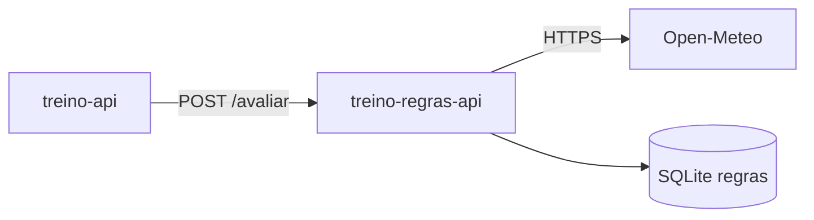

# Regras climáticas para treinos

Componente secundário do planejador de treinos ao ar livre. Consulta o [Open-Meteo](https://open-meteo.com/) e, de acordo com a regra do tipo de treino, responde se o treino está `apto`, pede `atencao` ou é melhor `cancelar`.



## Como a avaliação funciona

Cada tipo de treino tem uma regra com temperatura mínima e máxima, chuva máxima e vento máximo. Temperatura fora da faixa ou chuva acima do limite cancelam o treino. Vento forte só gera um alerta de atenção. As regras padrão são criadas na primeira vez que a API sobe e podem ser alteradas pelas rotas `/regras`.

## Rotas

| Método | Rota | O que faz |
| --- | --- | --- |
| GET | `/regras` | Lista as regras |
| POST | `/regras` | Cria uma regra (só uma por tipo de treino) |
| PUT | `/regras/{id}` | Altera os limites de uma regra |
| DELETE | `/regras/{id}` | Remove uma regra |
| GET | `/clima?cidade=Recife` | Clima atual da cidade. Com `&data_hora=2026-09-25T06:00`, mostra a previsão para esse horário |
| POST | `/avaliar` | Cruza o clima com a regra e devolve o status |
| GET | `/health` | Verifica se a API está no ar |

Exemplo de chamada:

```json
POST /avaliar
{
  "tipo_treino": "corrida",
  "cidade": "Recife",
  "data_hora": "2026-09-25T06:00:00"
}
```

O `data_hora` é opcional. Se não for enviado, a API usa o clima atual.

## Como rodar

```bash
python -m venv .venv
.venv\Scripts\activate
pip install -r requirements.txt
uvicorn app.main:app --reload --port 8001
```

A documentação Swagger fica em http://localhost:8001/docs.

## Docker

```bash
docker build -t treino-regras-api .
docker run --rm -p 8001:8001 --name treino-regras treino-regras-api
```
